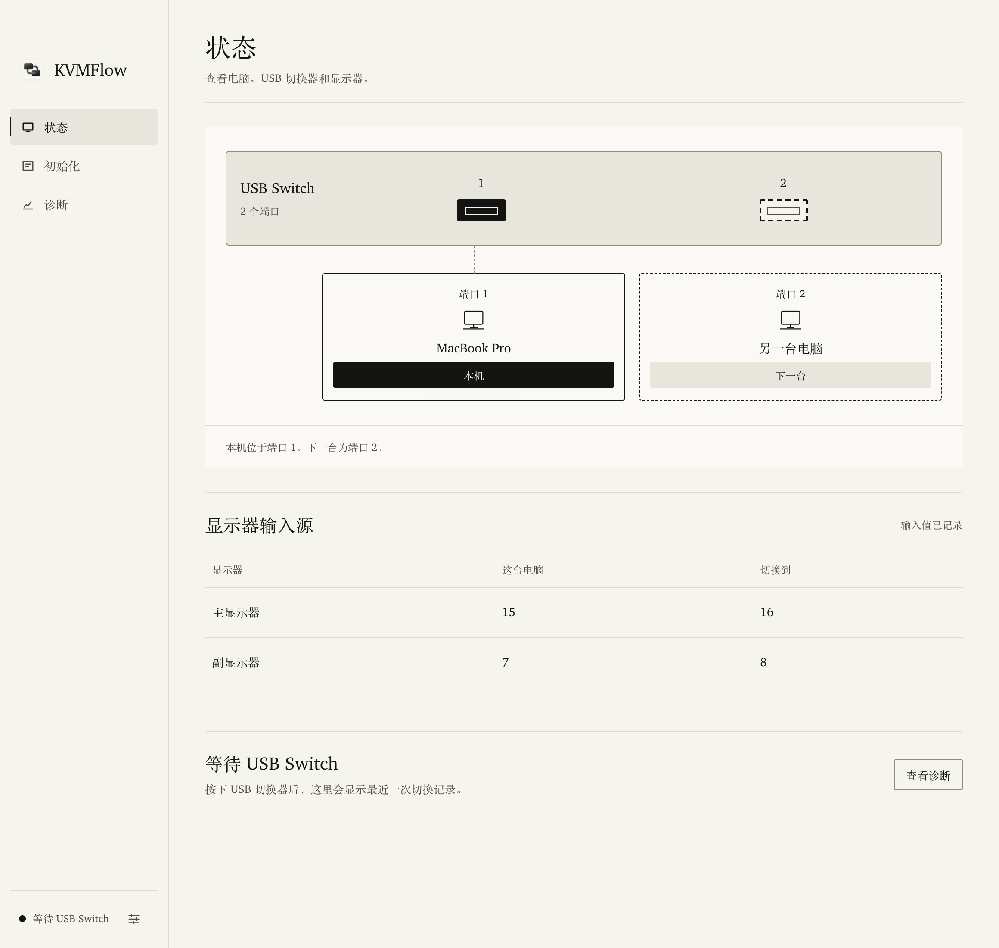

<div align="center">

<a href="https://kvmflow.net"></a>

# KVMFlow

### 一个按钮，键鼠与显示器一起切换。

**按下 USB 切换器，KVMFlow 自动切换显示器输入源。**<br>
本地桌面应用监听共享 USB 设备，通过 DDC/CI 发送切换指令，<br>
在电脑之间切换时，无需再逐台操作显示器菜单。

[](https://github.com/Kerw1n1209/KVMFlow/releases) [](https://github.com/Kerw1n1209/KVMFlow/stargazers) [](LICENSE)<br>
 

**[官网](https://kvmflow.net)** &nbsp;·&nbsp; **[下载与发行](https://github.com/Kerw1n1209/KVMFlow/releases)** &nbsp;·&nbsp; **[构建指南](docs/building.md)** &nbsp;·&nbsp; **[反馈问题](https://github.com/Kerw1n1209/KVMFlow/issues)** &nbsp;·&nbsp; [English](README.md) · **简体中文**

<br>

<table>
<tr>
<td align="center" width="25%"><h3>一个按钮</h3>键鼠与画面一起切换</td>
<td align="center" width="25%"><h3>混屏模式</h3>每台显示器固定给一台电脑</td>
<td align="center" width="25%"><h3>局域网配对</h3>在主力机上完成全部设置</td>
<td align="center" width="25%"><h3>本地运行</h3>不经过云端，不转发键鼠</td>
</tr>
</table>

</div>

## KVMFlow 适合你吗？

如果你的桌面上有多台电脑，共用一套键鼠和一台或多台显示器，KVMFlow 可以把 USB 切换与显示器切换连起来：USB Sharing Switch 负责连接键鼠，各台电脑分别通过视频线连接显示器，KVMFlow 负责发送输入源切换指令。

- **继续使用现有 USB 切换器。** 在初始化时识别共享设备组。
- **逐台记录显示器输入值。** 将原始 DDC/CI 输入值对应到各台电脑。
- **在本机完成日常切换。** USB 检测和输入切换都在本地运行；自动检查更新会访问更新服务。
- **随时控制运行状态。** 支持托盘运行、开机启动、暂停自动切换和诊断导出。
- **混屏模式（测试版）。** 把每台显示器固定分配给一台电脑，按 USB 切换器时只切键鼠，画面保持不动；关闭混屏时，另一台电脑会把屏幕切回来。
- **局域网配对（测试版）。** 两台电脑在同一局域网内自动发现，比对 6 位数字后配对。之后在主力机上完成全部设置，副机不用手填显示器输入值。

显示器需要支持通过 DDC/CI 切换输入源。KVMFlow 不通过网络传输键鼠输入，局域网只用来同步配置和协调切换。

## 快速开始

**1 · 在两台电脑上安装。** 产品介绍见 [kvmflow.net](https://kvmflow.net)，安装包在 [GitHub Releases](https://github.com/Kerw1n1209/KVMFlow/releases) 获取。桌面客户端支持 macOS Apple Silicon 和 Windows x64。安装包暂未经过商业代码签名，首次打开的处理方法见[安装提示](#安装提示)。

**2 · 连接设备。** 将共用键鼠接到 USB Sharing Switch，各台电脑的视频输出分别连接显示器的不同输入口，并在显示器 OSD 菜单中启用 **DDC/CI**。

**3 · 初始化。** 在两台电脑上打开 KVMFlow，在**初始化**中选择「这是主机」或「这是副机」。主机识别 USB Switch、记录本机显示器的输入值，再通过局域网连接副机；两边确认相同的 6 位数字后，副机的显示器信息会出现在主机上。副机读不到某台显示器的输入值时，用显示器按键把它切到副机一次即可。无法使用局域网时，也可以在主机上手动填写另一台电脑的输入值。

**4 · 按下 USB Switch。** 确认键鼠与显示器实际画面都切换到目标电脑。

在**设置 → 语言**选择跟随系统、简体中文或 English。语言偏好也会用于托盘、系统通知和原生确认弹窗。

### 混屏模式

在**设置**中打开混屏模式，并为每台显示器指定一台电脑。打开后立即生效：按 USB 切换器只切换键鼠，显示器保持各自的电脑；macOS 会暂时断开不属于本机的显示器，让光标不会移到看不见的屏幕上。托盘菜单也可以开关混屏。关闭时，KVMFlow 通过局域网让另一台电脑把屏幕切回来，所以两台电脑都需要在线。

Windows 上断开显示器的功能尚未完成真机验证，目前默认关闭。

### 安装提示

- **macOS**：如果提示无法验证开发者，打开「系统设置 → 隐私与安全性」，点「仍要打开」。首次使用局域网配对时，请允许「本地网络」权限。
- **Windows**：如果出现 SmartScreen 提示，点「更多信息 → 仍要运行」。局域网配对使用 TCP 47820 端口；网络类型为「公用」时，Windows 防火墙可能会拦截连接。
- **测试版**：在**设置**中打开「接收测试版」，可以通过应用内更新收到测试版本。

## 应用截图

截图来自 KVMFlow v0.2.7（混屏和配对界面的截图待更新），使用示例设备数据。输入值仅作演示，请按自己的显示器读取结果填写。



[查看初始化、设置和诊断页面](docs/screenshots/README.md)

## 如何工作


桌面客户端直接内嵌 Rust runtime。各台显示器有独立的输入映射，切换状态机负责时序、重试和重复保护；模拟测试可以在没有真实硬件时验证 runtime。

局域网通道使用 mDNS 发现同一网络内的 KVMFlow，连接经 Noise 协议加密，并通过 6 位数字比对确认对方身份；只有配对过的电脑才能同步配置或请求切换。

## 硬件注意事项

| 因素 | 需要检查什么 |
| :-- | :-- |
| **DDC/CI 支持** | 显示器、转接器、扩展坞和视频连接方式都会影响控制能力，请在显示器菜单启用 DDC/CI。 |
| **输入编码** | 不同厂商的输入源编码有差异，需要逐台记录原始数值。 |
| **非当前输入** | 某些显示器只在活动输入端响应 DDC/CI；软件会在 USB 离开时尝试发送切到对端的指令。 |
| **Windows 时序** | USB 移除通知可能晚于实际按键，延迟取决于系统和驱动。 |
| **画面确认** | DDC 调用成功表示指令已发送，仍需确认显示器实际画面。 |

如果切换失败，先用显示器菜单恢复正确输入，再检查 KVMFlow 的映射与诊断。导出的诊断会把设备序列号、电脑名称、用户目录路径和局域网地址替换成占位符；分享前仍请检查有没有其他个人信息。

## 开发

准备 Node.js LTS、Rust 和对应平台开发工具。macOS 需要 Xcode Command Line Tools；Windows 需要 MSVC Rust 工具链、Visual Studio C++ Build Tools、Windows SDK 和 WebView2。

```sh
git clone https://github.com/Kerw1n1209/KVMFlow.git
cd KVMFlow
cargo test --locked --manifest-path sidecar/Cargo.toml --workspace
cd desktop
npm ci
npm test
npm run smoke
npm run test:rust
npm start
```

开发与本地构建不需要官方更新签名私钥。macOS 构建会从仓库包含的 m1ddc 源码准备 DDC 工具。Linux 可运行核心、模拟 sidecar 和前端测试，但不属于原生硬件客户端的支持平台。

| 目录 | 内容 |
| :-- | :-- |
| `desktop/` | Tauri 2 客户端、本地界面、托盘和构建脚本 |
| `sidecar/` | Rust 切换状态机、USB/DDC 平台适配与模拟测试 |
| `probes/` | 硬件诊断、脱敏回归数据及 m1ddc 源码 |
| `shared/` | 统一品牌素材 |
| `docs/` | 本地构建和更新说明 |

界面文案与默认语言配置位于 [`messages.json`](desktop/src/renderer/i18n/messages.json)，前端和原生宿主共用此配置。维护方法与验证说明见[国际化配置指南](desktop/src/renderer/i18n/README.md)。

## 文档与反馈

- [构建指南](docs/building.md)：平台依赖及无需更新签名的本地构建。
- [更新说明](docs/auto-updates.md)：更新验签与发行配置。
- [贡献规范](CONTRIBUTING.md)：贡献范围、提交约定与检查。
- [Issues](https://github.com/Kerw1n1209/KVMFlow/issues)：请附系统、显示器和连接信息、复现步骤及脱敏诊断。

本仓库包含桌面软件及其构建依赖。官网、管理后台、云端运营服务和内部记录独立维护。

## 许可证

[MIT](LICENSE)。第三方代码保留原始许可和归属，见[第三方声明](THIRD_PARTY_NOTICES.md)。
